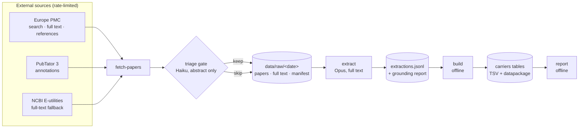

# Architecture

The pipeline is four stages. Each writes to disk, so any stage can be re-run without repeating the one before it.

Rejected candidates are still recorded in the snapshot, with the reason, so a triage change can be evaluated against them later. Only kept papers have their full text downloaded.

## Stages

**`fetch-papers`** searches Europe PMC and PubTator 3 for a date window, takes the union of PMIDs, triages the candidates, and downloads open-access full text only for the ones that survive. It writes `papers.jsonl`, the raw JATS XML per paper, and a `manifest.json` recording the queries, window, counts, request totals and rate-limiter sleep.

**`extract`** sends each kept paper to Claude and stores one structured record per paper in `extractions.jsonl`, together with the model, prompt version, schema version, token usage and a quote-grounding report. Papers already extracted at the current prompt version are skipped, so the command is safe to re-run.

**`build`** (not yet written) joins extractions to citation metadata and produces the published tables. It must be offline and deterministic from a single snapshot.

**`report`** (not yet written) diffs two snapshots into a monthly Markdown and HTML summary.

`list` and `show` are read-only views over a snapshot.

## Modules

| Module | Responsibility |
|---|---|
| `http.py` | The only network client for non-Anthropic hosts. Per-host token bucket, serial requests, retry with backoff on 429 and 5xx, SQLite response cache, contact-bearing User-Agent. |
| `sources/europepmc.py` | Search with cursor pagination, paper metadata including authors and affiliation, a prepared citation line, open-access full text, and the reference list for a paper. |
| `sources/pubtator.py` | Entity-aware search, BioC annotations, and variant mentions normalised to a specific gene. |
| `sources/ncbi.py` | Full-text fallback via E-utilities when Europe PMC has no XML. |
| `sources/fulltext.py` | JATS XML to plain text. Keeps table cells as rows, preserves tail text around removed inline elements, drops bibliographies and acknowledgements. |
| `extract/triage.py` | The cheap gate: does this abstract justify reading the paper? Haiku, cached by prompt version. |
| `extract/schema.py` | The Pydantic record. Deliberately flat; see the note in `AGENTS.md`. |
| `extract/prompt.py`, `extract/prompts/` | Versioned system prompt and the per-paper user message. |
| `extract/client.py` | The Opus call: structured output, prompt caching, refusal fallbacks, usage accounting. |
| `extract/verify.py` | String-matches every quote against the source and decides whether a record needs human review. |

## Data lifecycle

Bootstrap and monthly refresh run the same code; only the date window differs.

| Path | Tracked | Contents |
|---|---|---|
| `data/raw/<date>/` | no | Snapshot: paper metadata, full texts, extractions, manifest. Full texts are never redistributed. |
| `data/cache/http.sqlite` | no | Response cache, so a repeated fetch makes no network requests. |
| `data/curated/` | yes | Human-checked and hand-labelled artefacts, plus the triage decision log. Small, durable, worth keeping across clones. |
| `data/built/<date>/` | no | Generated tables. |
| `reports/<date>/` | yes | Published Markdown reports. |

Snapshots are dated directories and are never edited in place. A rebuild from an old snapshot must produce the same bytes.
