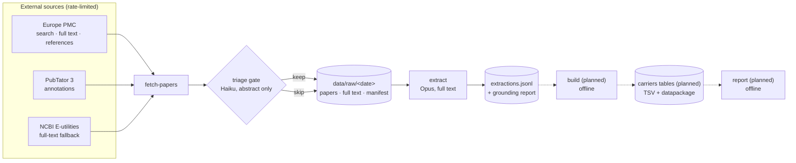

# Architecture

Each stage writes to disk, so any stage can be re-run without repeating the one before it. `build` and `report` are planned and drawn dashed.

Rejected candidates are still recorded in the snapshot and the ledger, with the reason, so a triage change can be evaluated against them later. Only kept papers have their full text downloaded.

## Stages

**`fetch-papers`** searches Europe PMC (in date slices, recorded in `discovery.jsonl`) and PubTator 3 for a date window, takes the union of PMIDs, triages the candidates, and downloads open-access full text only for the ones that survive. For those it also fetches the article's file bundle, parses any supplementary tables, and transcribes figures where the text looks to be missing its variants. It writes `papers.jsonl`, the raw JATS XML and bundle members per paper, and a `manifest.json` recording the queries, window, counts, request totals, rate-limiter sleep and what the supplement and figure stages cost.

**`extract`** sends each kept paper to Claude and stores one structured record per paper in `extractions.jsonl`, together with the served and requested model, effort, prompt version, schema version, token usage and a quote-grounding report. Papers already extracted at the current prompt version, requested model and text hash are skipped, so the command is safe to re-run; `--budget-usd` caps one run's spend.

**`build`** (planned) joins extractions to citation metadata and produces the published tables. It must be offline and deterministic from a single snapshot.

**`report`** (planned) diffs two snapshots into a monthly Markdown and HTML summary.

**`challenge`** asks a second model call to refute each extracted record, and verifies the reviewer's own output before storing it: a disputed verdict must cite a sentence that grounds against the paper text, or it is recorded as fabricated rather than believed.

`review` writes the human spot-check queue to `review.jsonl` in the snapshot from both review signals (grounding and challenge), with an optional TSV export. `list`, `show` and `ledger` are read-only views; `ledger` reports the denominator. `check` validates every tracked file and is run by `.githooks/pre-commit`.

## Modules

| Module | Responsibility |
|---|---|
| `http.py` | The only network client for non-Anthropic hosts. Per-host token bucket, serial requests, retry with backoff on 429 and 5xx, SQLite response cache, contact-bearing User-Agent. |
| `sources/europepmc.py` | Search with cursor pagination, paper metadata including authors and affiliation, a prepared citation line, open-access full text, and the reference list for a paper. |
| `sources/pubtator.py` | Entity-aware search, BioC annotations, and variant mentions normalised to a specific gene. |
| `sources/ncbi.py` | Full-text fallback via E-utilities when Europe PMC has no XML. |
| `sources/fulltext.py` | JATS XML to plain text. Keeps table cells as rows, preserves tail text around removed inline elements, drops bibliographies and acknowledgements. Also owns the prompt layout, the labelled text regions grounding uses, the figure and supplement inventory, and the figure cost gate. |
| `sources/supplements.py` | The article's file bundle: one streamed, size- and deadline-bounded request, ZIP member safety checks, and classification into figure renditions versus supplements. |
| `sources/tabular.py` | Supplement bytes to rows. Spreadsheets, Word, delimited files and PDFs, plus the row filtering that keeps the input affordable. Pure: no network, no JATS, no model. |
| `extract/figures.py` | Reading variant labels out of figure images, as a structured transcription, cached by image content. |
| `extract/triage.py` | The cheap gate: does this abstract justify reading the paper? Haiku, cached by prompt version and requested model. |
| `extract/schema.py` | The Pydantic record. Deliberately flat; see the note in `AGENTS.md`. |
| `extract/prompt.py`, `extract/prompts/` | Versioned system prompt and the per-paper user message. |
| `extract/client.py` | The Opus extraction call: streaming, prompt caching, usage accounting. |
| `extract/cache.py` | `KeyedCache`, the shape of the three caches of model answers; the newest `written_at` per key wins. |
| `extract/rows.py` | Which extraction and challenge rows are current, and which challenge reviewed which records. |
| `extract/llm.py` | The one path every Claude call takes: sends the structured-output schema, archives the raw response before validating it, replays an identical request from the archive, and stamps provenance (served and requested model, effort, time). |
| `extract/verify.py` | String-matches every quote against the source and decides whether a record needs human review. |
| `extract/derive.py` | Deterministic consistency checks and the `variant_type` cross-check. No model, no network. |
| `extract/challenge.py` | Adversarial review of records, and the verification of the reviewer's own claims. |
| `discovery.py` | Time-sliced Europe PMC search. A closed date range against a fixed query is sealed and cached forever; the query string is hashed into the slice key, so editing it re-opens every slice. |
| `config.py` | The one TOML file, resolved into a frozen `Settings` passed to every command. |
| `patterns.py` | Classifier regexes: gene mentions, HGVS-like tokens, the clinical vocabulary of the keyword triage rule. |
| `schemas.py`, `jsonl.py` | The row and document model for every file we write, found by filename, and the JSONL reader/writer that validates against it. `col4a1a2-dev export` writes these models to `schemas/` as JSON Schema. |
| `digest.py` | sha256 of bytes, text and canonical JSON, used by every resume and cache key. |
| `ledger.py` | Append-only record of every candidate ever considered, folded on read. Resume reads the extraction events, never the fold. |
| `check.py` | `col4a1a2 check`: parse and schema validity, duplicate rows, foreign keys, append-only logs and migration losses, and the links between tracked files and snapshots. Run by the pre-commit hook. |

## Data lifecycle

Bootstrap and monthly refresh run the same code; only the date window differs.

| Path | Tracked | Contents |
|---|---|---|
| `data/raw/<date>/` | no | Snapshot: paper metadata, full texts, extractions, manifest. Full texts are never redistributed. |
| `data/responses/<YYYY-MM>/` | no | Every raw Claude response, thinking included, one JSON document per call, archived before parsing. Paid for, so outside `data/cache/` and never evicted; untracked because thinking can paraphrase article text. |
| `data/cache/http.sqlite` | no | Response cache, so a repeated fetch makes no network requests. |
| `data/cache/bundles/<pmcid>/` | no | Supplementary files and figure images, shared across snapshots. The endpoint they come from fails or stalls for most requests, so a successful download is reused by every later run rather than re-attempted. |
| `data/curated/` | yes | `labels.json` (hand-assigned triage labels), `gold/` (human spot-check results), and the append-only logs `triage.jsonl`, `figures.jsonl`, `challenges.jsonl`, `discovery.jsonl` and `ledger.jsonl`. The logs use a union merge driver and are folded by `written_at`, so line order never changes the result. |
| `schemas/` | yes | JSON Schema for every artefact, exported from `schemas.py` and checked against it by the tests. |
| `data/built/<date>/` | no | Generated tables (planned). |
| `reports/<date>/` | yes | Published Markdown reports (planned). |

Snapshots are dated directories and are never edited in place. A rebuild from an old snapshot must produce the same bytes.
