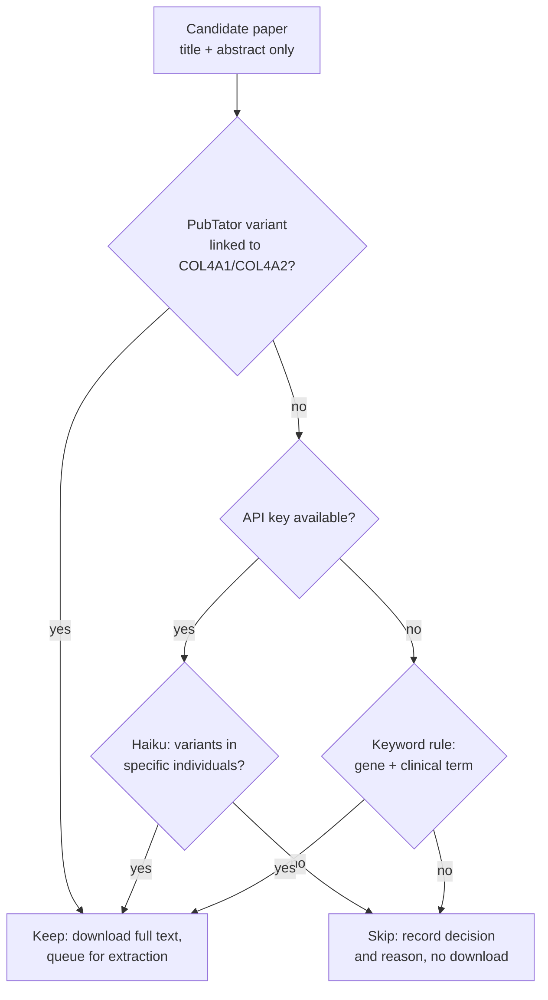

# Methods

How a paper becomes rows in the evidence table. Field-level rules are in `docs/codebook.md`; the numbers quoted here are recorded with their dates in `docs/measurements.md`.

## Finding candidates

Two searches run for each window and the union of PMIDs is taken.

The Europe PMC query requires COL4A1, COL4A2 or one of the three disease names to appear in the **title or abstract**. An unrestricted full-text match returns roughly ten times as many papers, mostly cancer, fibrosis and omics work that lists the gene in passing.

The disease names are there because the gene symbols alone have a measured blind spot: 16 papers say "Gould syndrome", PADMAL or "HANAC syndrome" and never name the gene, among them case reports and imaging series of exactly the kind this project exists for. The acronyms are matched as phrases: a bare HANAC also matches plant NAC transcription-factor papers and a 1950 laboratory method. Protein-name clauses are left out: "collagen type IV alpha 1" and its variants add 63 papers for one relevant hit already in the corpus. PubTator 3 contributes papers where it tagged both the gene and a variant mention, which catches clinical papers that name the gene only in the body.

PubTator returns PMIDs with no open-access status and no PMCID, so each
PubTator-only PMID is looked up in Europe PMC before the open-access filter can
judge it. **That lookup decides the size of the corpus**: it resolves about 98%
of its input, and a lookup that silently resolves a fraction would shrink the
corpus with no error. So it queries `EXT_ID` (Europe PMC has no `PMID` field),
drops the PMC-keyed duplicates that `EXT_ID` also matches, and records resolved
against requested in the manifest, warning when the ratio collapses. A PMID that
does not resolve is marked `metadata_source="pubtator_only"` and recorded as
`no_metadata`, never as closed access.

The query is deliberately broad, and we do not tighten it. Whatever a query excludes, we never see, so recall lost at search time is permanently unmeasurable. Filtering happens later, where the decision is recorded and auditable.

## Triage

Most candidates are irrelevant: the gate keeps about 9% of open-access candidates and about a third of closed-access ones, where clinical case reports are concentrated. Triage runs **before any full text is downloaded**, on title and abstract only, and asks one question: does this paper plausibly report a COL4A1 or COL4A2 variant carried by a specific individual?

Haiku answers it for about a hundredth of a cent per paper. The prompt is explicitly recall-biased, because a false yes costs one full-text read and a false no loses the evidence permanently. Decisions are cached by triage prompt version and requested model, so re-fetching a window is free.

Two refinements sit around the gate:

- A **PubTator variant mention normalised to COL4A1 or COL4A2** overrides a negative decision. PubTator's annotations carry the gene a variant belongs to, which makes this near-proof of relevance. It scores perfect precision but low recall, because PubTator usually annotates only the title and abstract, so it is a promoter and never a gate.
- A **keyword rule** is the fallback when no API key is present, via `--no-llm-triage`.

## Extraction

One Opus call per paper, at high effort, with the full text converted from JATS XML. Tables are flattened to rows and kept, because variant data often lives in them. The system prompt is cached, and refusal fallbacks are enabled.

Output is a single structured record per paper. The schema is flat by necessity: structured outputs compile to a grammar with a size budget, and a richer schema is rejected outright as too complex. Optional strings use the empty string for "not stated"; `n_total_carriers` alone stays nullable, and `n_tested` uses 0 for "not stated".

Precision is preferred over recall at this stage. The prompt tells the model to record absence of information as absence rather than inferring it. `phenotype_systems` lists only systems reported as affected, so "examined and normal" and "not mentioned" are both simply absent (see `docs/codebook.md`).

## Supplementary files and figures

Variant data often is not in the article body. One 44-patient cohort in the corpus reports 39 variants and names none of them in its text: they are in a figure and in supplementary tables. Reading only the body loses papers like that entirely.

One request per paper to Europe PMC's `supplementaryFiles` endpoint returns a ZIP holding both the supplementary files and the figure image renditions, so no publisher site is ever contacted. That endpoint builds its ZIP on demand, which makes it far more expensive to serve than a metadata call; at the host's normal rate it starts returning errors, so it has its own bucket at 0.25 requests per second. Downloads are streamed under a byte cap and a total wall-clock deadline, because some bundles send a few megabytes and then stall, which a per-read timeout cannot catch. Each bundle gets exactly one attempt per run: retrying an optional enrichment lets a few bad papers dominate a run's wall clock.

The ZIP is untrusted third-party data whose member names would otherwise be written straight to disk, so each member is checked for path escape and size before it is read.

Members are stored outside any snapshot, keyed by PMCID, and reused by every later run. That matters more than it sounds: the endpoint succeeds for roughly one request in five, so a per-snapshot store would throw away each success and re-attempt every paper from scratch.

**Supplements are parsed deterministically**: spreadsheets, Word documents, delimited files and PDFs all render into the same `[TABLE]` plus pipe-joined-rows format the article body uses, so they look identical to the model. A PDF yielding almost no text is probably scanned; that is recorded, never guessed at, and no OCR is attempted.

Row filtering keeps this affordable. A typical gene-panel supplement holds thousands of cells across many sheets, of which a couple of rows mention COL4A1 or COL4A2; appending it whole spends thousands of input tokens to convey two useful rows. So the first few rows of every sheet are kept unconditionally, because multi-row headers are the norm, then only rows naming our genes or something variant-shaped; small sheets pass through whole, since that is cheaper than risking the filter dropping the answer. Filtering is never silent: the rendered text says how many rows were kept of how many, and the counts are recorded per sheet. A quietly truncated cohort table would make the model confidently undercount, which is a correctness failure rather than a cost one.

**Figures are transcribed to text before extraction, never passed as images to it.** Grounding matches quotes against the exact string sent to the model, and an image has no string, so a fact read straight from one could never be verified. Transcribing first keeps grounding intact and leaves the transcription on disk as an auditable artefact. The transcription itself is a structured record rather than prose, for two reasons: asked for prose, the model will *infer* which panel of a schematic belongs to which gene, which would silently misassign every variant in it, and the rendered text is what quotes are matched against, so it must not vary with the model's prose style. The figure's own caption is supplied alongside the image so the model need not guess.

Vision is gated twice. Per paper: a paper whose text already names variants gains nothing from its figures and should not have model-transcribed evidence injected into it, so transcription runs only where the text names no variant while the paper claims a cohort. Per figure within those papers: figures cited from a paragraph that discusses variants are preferred. Caption keywords alone over-select badly, because imaging captions routinely say "in a patient with a COL4A1 variant" and some publishers emit no caption title at all. On the committed fixtures these two gates together select exactly one figure from the cohort paper and none from the case report.

## Grounding

Every variant record carries two to five verbatim quotes. `extract/verify.py` normalises whitespace, dashes and quote marks, then string-matches each quote against the source text. Any unmatched quote, and any low-confidence variant, puts the record on the spot-check queue. This is the main defence against fabricated detail, and it is not relaxed into fuzzy matching.

Grounding also records **which region** of the input each quote matched: author text, a parsed supplement, or a figure transcription. Provenance is therefore computed from the match rather than declared by the model, which is the only version of it worth auditing. The distinction matters because the guarantees differ. A quote matching a parsed supplement is as verifiable as one matching a body table, since the parse is deterministic. A quote matching a figure transcription proves only fidelity to the transcription, so those records are flagged, are not given high confidence, and go to the front of the spot-check queue. Each region is normalised separately, which makes matching marginally stricter at the seams: a quote spanning two regions does not ground, which is correct, since it is verbatim in neither source.

## Deduplication

The same family can be reported in several papers, and papers carry no patient identifiers. Left alone this inflates proband counts, and the error runs one direction only: toward overstating how much evidence a variant has.

The problem is bounded. The variant string is itself the join key, and Europe PMC indexes full text, so asking which papers mention a given variant returns a handful rather than a corpus. This is a per-variant question over a few papers, not corpus-wide record linkage.

Signals available without patient identifiers:

1. **Rarity sets the prior.** A private variant appearing twice probably means one family; a recurrent variant genuinely appears in independent families. Allele frequency comes from the annotation step.
2. **Author and centre overlap**, from the author list and first-author affiliation already stored with each paper.
3. **Explicit statements**, which the schema captures, resolved against the paper's actual reference list.
4. **Clinical fingerprint**, useful for confirmation but too fuzzy to lead.

Citation links are weak in both directions and should not be relied on as a general instrument. Measured across papers reporting the same recurrent variant, only about a fifth of later-earlier pairs cite each other, and bibliographies run to over a hundred entries, so a citation is one of dozens. Absence of a citation says almost nothing. Its one reliable use is narrow: resolving which paper an explicit prior-report claim refers to.

Two design rules follow:

- **Count probands only from primary reports.** Reviews and meta-analyses cite their sources exhaustively and are the papers most likely to recycle published patients, so they serve as pointers and contribute no counts.
- **Represent the uncertainty rather than resolving it.** Publish one row per variant per paper, which needs no dedup decision and is always correct, plus a roll-up that reports a range: fewest distinct probands assuming every possible overlap is real, most assuming all are independent, with the distinct centre count and the contributing PMIDs. The width of that range is itself the signal. Nothing merges silently, and any dedup verdict carries its reasoning.

Residual risk, to be stated wherever the table is published: large cohort papers that report totals without per-patient variant detail can overlap earlier case reports invisibly, and consortia reuse cohorts.

## Output format

Working files are JSON Lines, one object per record, carrying full provenance: model, prompt and schema versions, token usage and the grounding report.

Published tables are tab-separated with a `datapackage.json` descriptor that names, types and defines every column, so the table is machine-readable rather than merely parseable. Tabs rather than commas is a measured choice: about half the extracted quotes contain commas and none of the extracted text contains a tab or a newline. The writer still rejects them rather than trusting that.

Every row carries both a prepared one-line citation and the structured identifiers it was built from.

## Peer review of what the model derives

Three artefacts here are model-derived: triage decisions, figure transcriptions
and extraction records. Grounding already protects the last of those against
fabricated detail, but it answers only "does this sentence appear in the text",
not "does this sentence support the claim".

So `col4a1a2 challenge` runs one call per extracted paper that tries to refute
each record, and the reviewer's own output is verified before any of it is
stored. A disputed verdict must cite the contradicting sentence verbatim, and
that sentence goes through the same grounding machinery as an evidence quote.
An ungrounded refutation is recorded as **fabricated** rather than stored as a
verdict.

Be precise about what that buys. It catches a reviewer inventing a
contradiction. It does not catch one quoting a real sentence that does not
actually refute the claim, which is the likeliest over-refutation mode for
count disputes. The number is therefore a fabrication rate and is named that;
**there is no precision estimate for either extraction or review until
`data/curated/gold/` is populated by hand**, and until then challenge verdicts
are advisory and labelled so wherever they appear.

Two deliberate omissions. The reviewer is not asked how confident it is, since
a self-report about a judgement is worth less than the grounded quote beside it.
And it never runs as a second turn of the extraction conversation, which would
let the paper text be read from cache and cut input cost by nearly half, because
the model would then be reviewing its own prior output. A fresh conversation
presenting the records as another analyst's work is far likelier to refute.

`missed_variants` is the most valuable thing it produces, because grounding
those strings makes extraction *recall* computable: a variant designation
present verbatim in the text with no record is a real miss, and one absent from
the text is an invention. It is also why papers that yielded no records are
reviewed rather than skipped. One caveat: in a paper with a genome-wide
association section, most "missed" variants are common SNPs that should not be
records at all, so the count needs a relevance filter before it can be read as
recall.

Nothing the reviewer proposes is applied. Count corrections are named
`proposed_*`, `extractions.jsonl` is never rewritten, and `col4a1a2 review`
writes the whole queue to `review.jsonl` for a human, with a TSV export on
request.

## Deterministic checks

`extract/derive.py` holds what can be computed rather than asked for, and the
module is honest about its yield. The consistency checks -- inheritance sums,
families against probands and tested, carriers against probands, phenotype
vocabulary, a prior-report flag without a reason, a copy-number gain typed as a
deletion -- rarely fire (4 findings over the 233 records in the current corpus). Deriving `variant_type` from nomenclature is *worse* than the model
where no protein change is printed, so it is a cross-check on the unambiguous
subset and the model's value is still what gets published; predicate order
matters, because a glycine-first rule would misclassify records where
`p.(Gly423Trpfs*19)` is a frameshift and `p.(Gly2=)` is synonymous.

One check guards the costliest counting error. `n_families <= n_probands` holds
for a population biobank's carriers recorded as as many distinct families, so a
separate check flags families equal to probands at implausible magnitude, and
`many_families_from_a_cohort` flags a large family count out of a screen of
thousands. The codebook's rule (families are 0 for screened carriers) keeps
both quiet on the current corpus.
