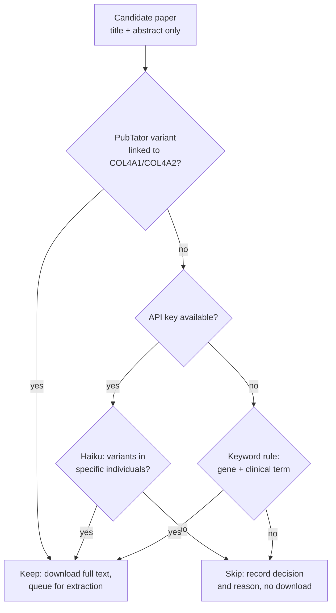

# Methods

How a paper becomes rows in the evidence table. Field-level rules are in `docs/codebook.md`; the numbers quoted here are recorded with their dates in `docs/measurements.md`.

## Finding candidates

Two searches run for each window and the union of PMIDs is taken.

The Europe PMC query requires the gene to be named in the **title or abstract**. An unrestricted full-text match returns roughly ten times as many papers, mostly cancer, fibrosis and omics work that lists the gene in passing. PubTator 3 contributes papers where it tagged both the gene and a variant mention, which catches clinical papers that name the gene only in the body.

The query is deliberately broad, and we do not tighten it. Whatever a query excludes, we never see, so recall lost at search time is permanently unmeasurable. Filtering happens later, where the decision is recorded and auditable.

## Triage

Most candidates are irrelevant: in the first measured window, 15 of 20 papers that reached extraction had nothing to extract. Triage runs **before any full text is downloaded**, on title and abstract only, and asks one question: does this paper plausibly report a COL4A1 or COL4A2 variant carried by a specific individual?

Haiku answers it for about a tenth of a cent per paper. The prompt is explicitly recall-biased, because a false yes costs one full-text read and a false no loses the evidence permanently. Decisions are cached by triage prompt version, so re-fetching a window is free.

Two refinements sit around the gate:

- A **PubTator variant mention normalised to COL4A1 or COL4A2** overrides a negative decision. PubTator's annotations carry the gene a variant belongs to, which makes this near-proof of relevance. It scores perfect precision but low recall, because PubTator usually annotates only the title and abstract, so it is a promoter and never a gate.
- A **keyword rule** remains as the fallback when no API key is present, via `--no-llm-triage`.

## Extraction

One Opus call per paper, at high effort, with the full text converted from JATS XML. Tables are flattened to rows and kept, because variant data often lives in them. The system prompt is cached, and refusal fallbacks are enabled.

Output is a single structured record per paper. The schema is flat by necessity: structured outputs compile to a grammar, and a richer draft was rejected outright. Optional strings use the empty string for "not stated"; the segregation counts stay nullable, because zero and unknown are different facts.

Precision is preferred over recall at this stage. The prompt tells the model to record absence of information as absence rather than inferring it, and the three-state phenotype fields exist so that "examined and normal" is never collapsed into "not mentioned".

## Supplementary files and figures

Variant data often is not in the article body. One 44-patient cohort reporting 39 variants had none of them in its text: they were in a figure and in supplementary tables. Reading only the body loses papers like that entirely.

One request per paper to Europe PMC's `supplementaryFiles` endpoint returns a ZIP holding both the supplementary files and the figure image renditions, so no publisher site is ever contacted. That endpoint builds its ZIP on demand, which makes it far more expensive to serve than a metadata call; at the host's normal rate it starts returning errors, so it has its own bucket at one request every ten seconds. Downloads are streamed under a byte cap and a total wall-clock deadline, because at least one bundle sends a few megabytes and then stalls forever, which a per-read timeout cannot catch.

The ZIP is untrusted third-party data whose member names would otherwise be written straight to disk, so each member is checked for path escape and size before it is read.

Members are stored outside any snapshot, keyed by PMCID, and reused by every later run. That matters more than it sounds: measured over 100 papers, only 19 bundle requests succeeded, the rest timing out or stalling. A per-snapshot store would throw away each success and re-attempt every paper from scratch.

**Supplements are parsed deterministically**: spreadsheets, Word documents, delimited files and PDFs all render into the same `[TABLE]` plus pipe-joined-rows format the article body uses, so they look identical to the model. A PDF yielding almost no text is probably scanned; that is recorded, never guessed at, and no OCR is attempted.

Row filtering keeps this affordable. One measured supplement held 1,512 cell strings across 11 sheets covering 859 genes, of which two mentioned COL4A1 or COL4A2. Appending it whole would have spent some 3,600 input tokens to convey two useful rows. So the first few rows of every sheet are kept unconditionally, because multi-row headers are the norm, then only rows naming our genes or something variant-shaped; small sheets pass through whole, since that is cheaper than risking the filter dropping the answer. Filtering is never silent: the rendered text says how many rows were kept of how many, and the counts are recorded per sheet. A quietly truncated cohort table would make the model confidently undercount, which is a correctness failure rather than a cost one.

**Figures are transcribed to text before extraction, never passed as images to it.** Grounding matches quotes against the exact string sent to the model, and an image has no string, so a fact read straight from one could never be verified. Transcribing first keeps grounding intact and leaves the transcription on disk as an auditable artefact. The transcription itself is a structured record rather than prose, for two reasons: a probe showed the model willing to *infer* which panel of a schematic belonged to which gene, which would silently misassign every variant in it, and the rendered text is what quotes are matched against, so it must not vary with the model's prose style. The figure's own caption is supplied alongside the image so the model need not guess.

Vision is gated twice. Per paper: a paper whose text already names variants gains nothing from its figures and should not have model-transcribed evidence injected into it, so transcription runs only where the text names no variant while the paper claims a cohort. Per figure within those papers: figures cited from a paragraph that discusses variants are preferred. Caption keywords alone over-select badly, because imaging captions routinely say "in a patient with a COL4A1 variant" and some publishers emit no caption title at all. On the committed fixtures these two gates together select exactly one figure from the cohort paper and none from the case report.

## Grounding

Every variant record carries two to five verbatim quotes. `extract/verify.py` normalises whitespace, dashes and quote marks, then string-matches each quote against the source text. Any unmatched quote, and any low-confidence variant, puts the record on the spot-check queue. This is the main defence against fabricated detail, and it is not relaxed into fuzzy matching.

Grounding also records **which region** of the input each quote matched: author text, a parsed supplement, or a figure transcription. Provenance is therefore computed from the match rather than declared by the model, which is the only version of it worth auditing. The distinction matters because the guarantees differ. A quote matching a parsed supplement is as verifiable as one matching a body table, since the parse is deterministic. A quote matching a figure transcription proves only fidelity to the transcription, so those records are flagged, are not given high confidence, and go to the front of the spot-check queue. Each region is normalised separately, which makes matching marginally stricter at the seams: a quote spanning two regions no longer grounds, which is correct, since it is verbatim in neither source.

## Deduplication

The same family can be reported in several papers, and papers carry no patient identifiers. Left alone this inflates proband counts, and the error runs one direction only: toward overstating how much evidence a variant has.

The problem is bounded. The variant string is itself the join key, and Europe PMC indexes full text, so asking which papers mention a given variant returns a handful rather than a corpus. This is a per-variant question over a few papers, not corpus-wide record linkage.

Signals available without patient identifiers:

1. **Rarity sets the prior.** A private variant appearing twice probably means one family; a recurrent variant genuinely appears in independent families. Allele frequency comes from the annotation step.
2. **Author and centre overlap**, from the author list and first-author affiliation already stored with each paper.
3. **Explicit statements**, which the schema captures, resolved against the paper's actual reference list.
4. **Clinical fingerprint**, useful for confirmation but too fuzzy to lead.

Citation links are weak in both directions and should not be relied on as a general instrument. Measured across papers reporting the same recurrent variant, only about a fifth of later-earlier pairs cite each other, and bibliographies run to over a hundred entries, so a citation is one of dozens. Absence of a citation says almost nothing. Its one reliable use is narrow: resolving which paper an explicit prior-report claim refers to.

Two design rules follow:

- **Count probands only from primary reports.** Reviews and meta-analyses cite their sources exhaustively and are the papers most likely to recycle published patients, so they serve as pointers and contribute no counts.
- **Represent the uncertainty rather than resolving it.** Publish one row per variant per paper, which needs no dedup decision and is always correct, plus a roll-up that reports a range: fewest distinct probands assuming every possible overlap is real, most assuming all are independent, with the distinct centre count and the contributing PMIDs. The width of that range is itself the signal. Nothing merges silently, and any dedup verdict carries its reasoning.

Residual risk, to be stated wherever the table is published: large cohort papers that report totals without per-patient variant detail can overlap earlier case reports invisibly, and consortia reuse cohorts.

## Output format

Working files are JSON Lines, one object per record, carrying full provenance: model, prompt and schema versions, token usage and the grounding report.

Published tables are tab-separated with a `datapackage.json` descriptor that names, types and defines every column, so the table is machine-readable rather than merely parseable. Tabs rather than commas is a measured choice: about half the extracted quotes contain commas and none of the extracted text contains a tab or a newline. The writer still rejects them rather than trusting that.

Every row carries both a prepared one-line citation and the structured identifiers it was built from.
